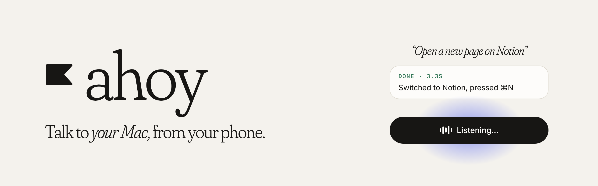

<picture>
  <source media="(prefers-color-scheme: dark)" srcset="assets/banner-dark.png">
  
</picture>

Ahoy is a voice assistant that lets you control your Mac from your phone. It's like Wispr Flow, but it acts instead of typing: hold to talk, say *"open Notion"* or *"search the news"*, and it's done.

### How it works

1. **Pair once.** The Mac app shows a QR code; scan it with the Ahoy iPhone app.
2. **Hold to talk.** Ahoy only listens while you hold the button.
3. **Your Mac does it.** Ahoy reads what's on your screen, finds the right app or button, then clicks, types or searches for you.
4. **It asks instead of guessing.** If two things match, numbered tags appear on your Mac and your phone asks *"Which one?"*.
5. **Nothing risky without you.** Deleting or sending always needs a tap on your phone.

### Repositories

| | |
|---|---|
| [**mobile**](https://github.com/getahoy/mobile) | The iPhone app: hold to talk, choices, spoken replies (Expo, React Native) |
| [**agent**](https://github.com/getahoy/agent) | The Mac app that reads your screen and does the work (Electron, Swift) |
| [**web**](https://github.com/getahoy/web) | The website and the API: sign-in, pairing, speech and command understanding (Next.js) |
| [**shared**](https://github.com/getahoy/shared) | Types, protocol and copy shared by every app |
| [**docs**](https://github.com/getahoy/docs) | Architecture, system design and setup guides |

### Built with

Expo · React Native · Electron · Swift · Next.js · ElevenLabs · Claude

The phone and the Mac talk over an end-to-end encrypted connection on your local network. Today they need to be on the same Wi-Fi.

Made in India by [Shahwaiz](https://github.com/CoderXYZ14).
